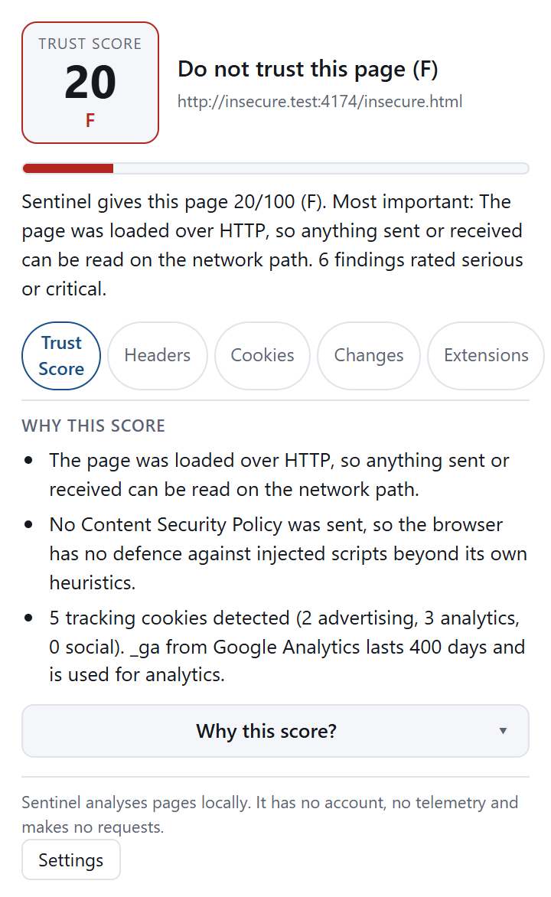
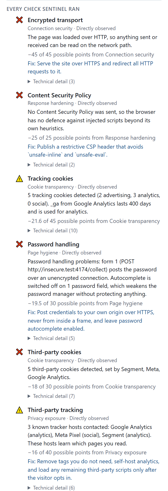
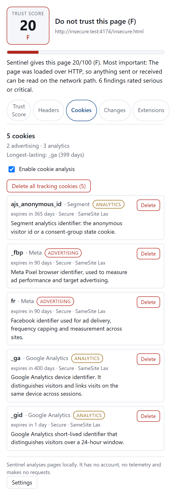

# Sentinel

[](https://github.com/caseymccallum/sentinel/actions/workflows/verify.yml)

**Local-first trust and privacy analysis for websites.** Sentinel scores the page you are on,
explains every point it deducts in plain language, and never phones home: no account, no telemetry,
no network requests, ever.

**Sentinel is an assessment tool, not a blocker.** It tells you what the page you are on is doing and
why it matters; it does not stop it. uBlock Origin blocks, Sentinel explains — the two are
complementary, and Sentinel is deliberately useless to anyone looking for a block-everything button.



*The popup on the worst page in the test fixtures: plain HTTP, no security headers, three trackers
and a password form that posts in the clear. Every image in this README is produced by
`npm run screenshots`, so you can re-derive them rather than take our word for it.*

## What it does

- **Trust Score** — one 0–100 number and a letter grade, built from five categories: connection
  security (20%), response hardening (20%), privacy exposure (25%), page hygiene (15%) and cookie
  transparency (20%). Every deduction names what was measured, what it cost, and what the site owner
  could fix.
- **Cookies** — every cookie the page and its third parties set, with what each one is for, who set
  it, how long it lasts, and whether deleting it is safe. Tracking cookies can be deleted
  individually or all at once, always behind a confirmation. Cookie *values* are never read, stored
  or shown.
- **Changes** — what each site looked like on your last visit (locally, per domain, metadata only)
  and what has moved since: a score drop, a new tracker, a header that disappeared. Change findings
  never alter the Trust Score.
- **Headers** — the response headers the site actually sent, beside the values good practice
  recommends. Informational and weightless.
- **Extensions** — the other extensions you have installed, reviewed for over-broad permissions.
  Read-only, fetched on demand, never persisted, and never part of any page's score.

<details>
<summary>Two more images: the drill-down behind the score, and the Cookies panel</summary>





</details>

## Verify the claims yourself

Sentinel's whole argument is that a promise nobody checks is worth nothing, so the claims it makes
about itself are each enforced by a gate you can run:

| Claim | What enforces it |
| --- | --- |
| **Local-first** — nothing leaves the browser | `npm run check:local-only` scans every source file *and* every built bundle for `fetch`, `XMLHttpRequest`, `WebSocket`, `EventSource`, `sendBeacon`, `WebTransport`, `RTCPeerConnection`, `importScripts`, remote `import()` and remote `<script src>`, then reads each built `manifest.json` for widened permissions. |
| **Observational, never interference** — Sentinel reads what the browser already did | The same gate forbids `webRequestBlocking`, `declarativeNetRequest` and `proxy` in the built manifest. The content scripts only read: two tests assert a page's DOM is byte-identical after an observation. |
| **Every number inspectable** — scoring is data plus arithmetic, not vibes | `src/core/scoring-model.ts` holds weights, budgets and caps as data; the unit suite asserts the weights sum to exactly 1 and that every category has exactly 100 points of budget. [`docs/SCORING.md`](docs/SCORING.md) is the prose contract. |
| **Small enough to audit** | `npm run check:size` fails a built target above 400 kB, or any single file above 200 kB. |
| **Read-only extension auditing** | The gate machine-forbids `management.setEnabled`, `management.uninstall` and `management.uninstallSelf` (D-010). |

```bash
git clone https://github.com/caseymccallum/sentinel
cd sentinel
npm ci
npm run verify               # icons, typecheck, 440 unit tests, Chrome build, both gates
ls -la .output/chrome-mv3    # 15 files. Read them.
```

`npm run test:e2e` goes further: it builds the extension, serves fixture pages from `127.0.0.1`,
drives the real popup in headless Chromium and asserts what it displays.

## Install

Not in any store yet. Sentinel is at 0.2.0: both packages build (`npm run zip`, `npm run zip:firefox`),
every gate is green, and the two manual checks in [`docs/RELEASE.md`](docs/RELEASE.md) §4 and §5 — a
zero-outbound-request pass in DevTools over real sites, and a Firefox smoke test — are what stand
between this and a store listing. A release whose manual steps are undocumented is not a completed
release, so the checklist is the gate.

```bash
npm ci
npm run build          # Chrome/Edge: load .output/chrome-mv3 as an unpacked extension
npm run build:firefox  # Firefox: load .output/firefox-mv3 from about:debugging
npm run dev            # Chrome, with live reload
```

## Privacy: what Sentinel does and does not do

Everything Sentinel knows stays in your browser. It makes no requests, ships no remote code, and
stores nothing beyond your own browser's session, local and settings storage.

**About the `cookies` permission:**

> Sentinel reads cookies to explain what they are and how long they last. It never sends cookie
> data anywhere. It never modifies cookies without your explicit action.

Concretely:

- Sentinel reads cookie **metadata only** — names, domains, lifetimes and flags. It never reads,
  stores or displays a cookie's *value*. A unit test feeds a canary value through the reader and
  proves the secret appears nowhere in the output.
- `chrome.cookies.set()` is never called. `chrome.cookies.remove()` runs only when you click a
  Delete button in the popup, and a bulk delete always asks for confirmation first.
- Every permission is justified in writing in [`docs/ARCHITECTURE.md`](docs/ARCHITECTURE.md)
  (D-007 for cookies, D-010 for `management`) and enforced by the `check:local-only` gate, which
  fails the build if the manifest ever requests anything else.
- What Sentinel explicitly cannot do for you — and why — is in
  [`docs/THREAT-MODEL.md`](docs/THREAT-MODEL.md).

## Documentation

- [`docs/THREAT-MODEL.md`](docs/THREAT-MODEL.md) — what Sentinel protects against, and what it
  explicitly does not.
- [`docs/SCORING.md`](docs/SCORING.md) — every number behind the score, and why each weight is what
  it is.
- [`docs/ARCHITECTURE.md`](docs/ARCHITECTURE.md) — why the system is shaped this way, with the
  decision record (D-001 … D-013) and the alternatives that were rejected.
- [`docs/DEVELOPMENT.md`](docs/DEVELOPMENT.md) — invariants, gates, and the traps that have already
  cost time once.
- [`docs/RELEASE.md`](docs/RELEASE.md) — the release checklist.

## Development

```bash
npm install
npm run dev            # build with live reload
npm run verify         # icons → typecheck → unit tests → build → local-only gate → size gate
npm run test:e2e       # the money test: builds, serves local fixtures, drives the popup
npm run screenshots    # regenerate the images in this README (Node 23+)
```

Contributions are welcome: [`CONTRIBUTING.md`](CONTRIBUTING.md) covers what earns its place here, and
the issue templates ask for the argument — and the arithmetic — up front.

## Status

Pre-release, and honest about it:

- **Firefox** is built and gate-checked but not covered by the e2e suite, which is Chromium-only
  (D-012). The Firefox build gets a manual smoke test per release.
- **Chrome does not expose TLS or certificate facts** to extensions, so two connection checks report
  "not measured" there — which removes no points (D-006), and is recorded as a limitation in the
  threat model rather than hidden.
- **No reputation data, by design** (D-004). Sentinel will never tell you a site is "known bad"; it
  describes what it observed.
- **`MODEL_VERSION` travels with every stored result**, so a score read back from history can be read
  in the context of the model that produced it (`docs/RELEASE.md` §1).

## License

MIT — see [LICENSE](LICENSE).

